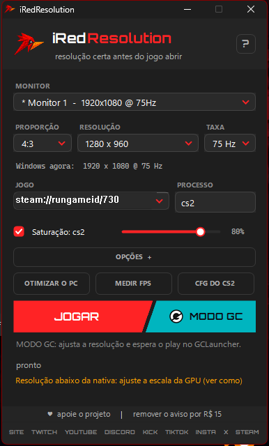
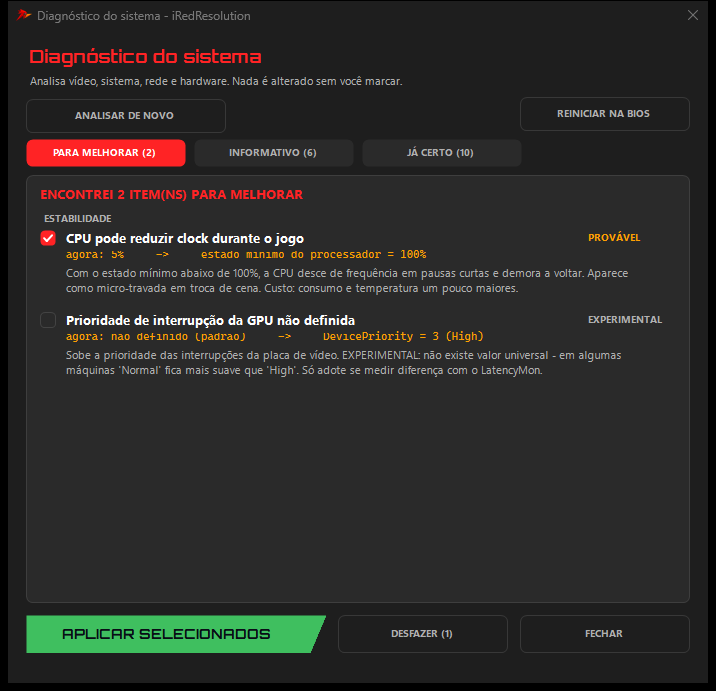
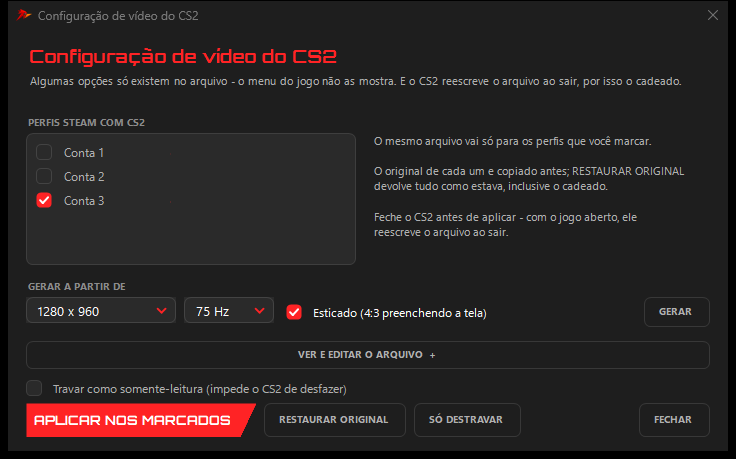
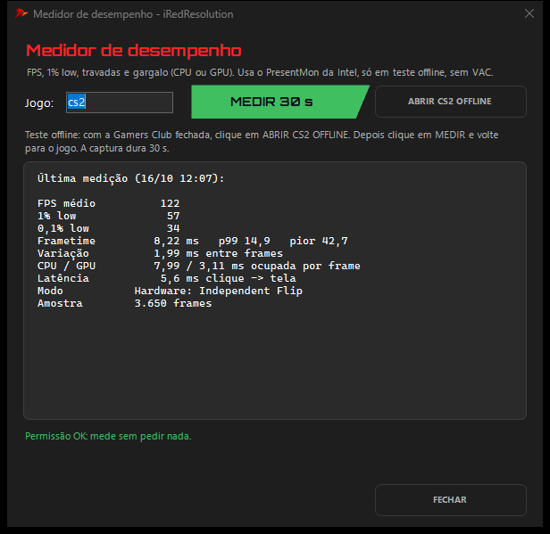
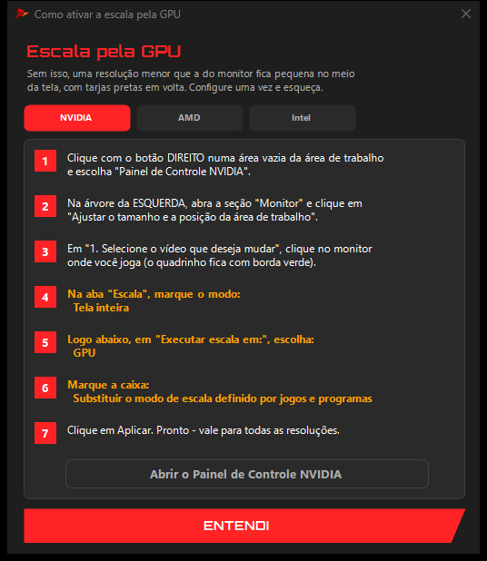
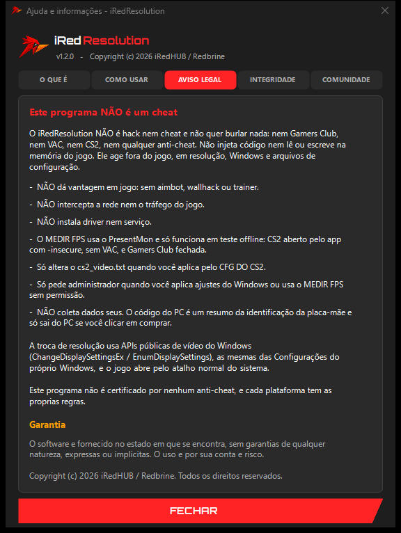
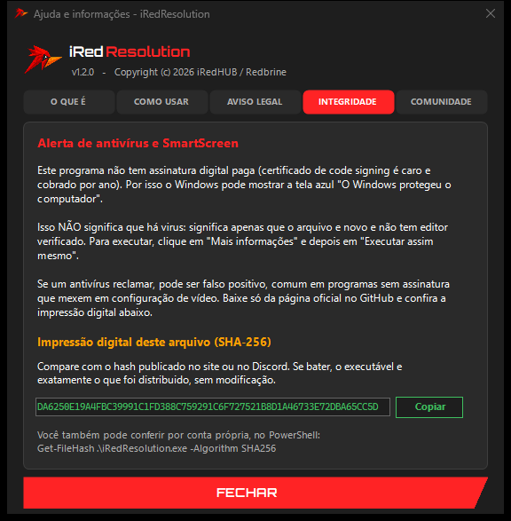

<div align="center">


# iRedResolution

**Reduza o alt-tab lento do CS2 mantendo a tela cheia exclusiva.**

Troca a resolução do monitor *antes* do jogo abrir e restaura ao fechar.

[](../../releases/latest)
[-1E1E1E?style=for-the-badge&logo=windows)](#requisitos)
[](https://discord.gg/DQ8TzaFGtd)

*1,8 MB · arquivo único · sem instalação*



</div>

---

## O problema

Se você joga CS2 numa resolução diferente da área de trabalho, como 4:3 esticado, pode conhecer o sintoma: cada alt-tab vira **preto → cinza → preto** e demora.

Em tela cheia exclusiva, o jogo define o modo de vídeo. Se esse modo for diferente do modo da área de trabalho, o monitor pode perder o sinal e sincronizar de novo a cada troca.

## A solução

Em vez de mudar o jogo, o iRedResolution muda a **área de trabalho**:

```
1. área de trabalho  ->  resolução do jogo
2. abre o jogo
3. ao fechar o jogo  ->  restaura a resolução
```

Com área de trabalho e jogo na mesma resolução, não há troca de modo no alt-tab. No PC usado no desenvolvimento, as piscadas sumiram mantendo o modo exclusivo. **O resultado pode variar:** driver, monitor e programas abertos também influenciam. Programas que reaplicam saturação a cada troca de foco, por exemplo, podem causar piscadas.

---

## Recursos

| | |
|---|---|
| **JOGAR** | Troca a resolução, abre o jogo e restaura ao fechar |
| **MODO GC** | Aplica a resolução e espera o seu play no GCLauncher, na FACEIT ou em outros launchers |
| **Perfis por jogo** | Cada jogo lembra a própria proporção, resolução e Hz |
| **Detecção automática** | Vigia os processos listados; nesse modo, a resolução só troca depois do jogo abrir |
| **Vários monitores** | Lista os monitores e reconhece o escolhido mesmo se o Windows renumerá-los |
| **Modos reais** | Mostra as resoluções e os Hz que o monitor informa ao Windows |
| **Restauração** | Volta ao fechar o jogo. Se o app ou o PC cair antes disso, volta quando o app abrir de novo |
| **Monitores virtuais** | Detecta Sunshine, Parsec, spacedesk e similares, e pergunta antes de desativá-los durante o jogo |
| **OTIMIZAR O PC** | Diagnóstico com selo de confiança; você escolhe o que aplicar |
| **CFG DO CS2** | Edita o `cs2_video.txt` dos perfis marcados, com backup |
| **Saturação por jogo** | Digital Vibrance na NVIDIA; em Intel e AMD, pelo controle do driver quando ele aceita; nas demais, pelo efeito de cor do Windows (vale para todas as telas e pode não aparecer em jogo em tela cheia exclusiva). Restaura ao fechar o jogo |
| **MEDIR FPS** | FPS, 1% low e gargalo, só em teste offline |
| **Presets** | CS2, Valorant, Apex, Dota 2, TF2, Rocket League e personalizado |

## MODO GC

GCLauncher e FACEIT abrem o jogo pelo próprio launcher. Como a resolução precisa trocar **antes**, o processo fica assim:

```
1. clique em MODO GC     ->  resolução aplicada
2. o programa espera na bandeja
3. clique em Jogar no launcher, como sempre
4. ao fechar o CS2       ->  resolução restaurada
```

Se desistir, o botão vira CANCELAR. Após 15 minutos sem o jogo abrir, a resolução volta sozinha.

## OTIMIZAR O PC

<div align="center">

</div>

Nada muda sem você marcar e confirmar. Alguns ajustes pedem administrador (UAC).

| Selo | O que significa |
|---|---|
| **COMPROVADO** | Mecanismo documentado, com efeito conhecido |
| **PROVÁVEL** | Pode ajudar, mas o ganho não foi medido em toda máquina |
| **EXPERIMENTAL** | Resultado varia ou é incerto; vem desmarcado |
| **INFO** | Só informa, sem correção automática |

Inclui, entre outros, MPO, HAGS, Game DVR, aceleração do mouse, estado mínimo da CPU e prioridade alta do CS2. **A prioridade alta não teve ganho medido** e é gravada pelo Windows (`Image File Execution Options`), sem o app tocar no processo do jogo. Se o áudio falhar ou surgirem travadas, use o **DESFAZER**.

O DESFAZER reverte todos os ajustes aplicados. O ajuste de MSI é experimental e só vale depois de reiniciar: em placa ou driver incompatível pode causar tela preta ao iniciar. Nesse caso, entre no Modo de Segurança e rode `iRedResolution.exe --desfazer`.

## CFG DO CS2

<div align="center">

</div>

Serve para opções que o menu do jogo não mostra. Só marca a conta Steam em uso, oferece as resoluções do seu monitor e guarda o original antes de gravar. A trava de somente leitura é opcional.

## MEDIR FPS: só em teste offline

<div align="center">

</div>

O medidor usa o [PresentMon](https://github.com/GameTechDev/PresentMon) da Intel, um programa à parte que observa o sistema. Para manter a regra deste projeto, ele só libera quando:

- o CS2 foi aberto pelo botão **ABRIR CS2 OFFLINE**, que usa `-insecure` naquela sessão e **desliga o VAC**;
- o Gamers Club Anti-Cheat está fechado.

Sem o VAC, você não entra em servidores seguros. A liberação acaba quando o CS2 fecha.

---

## Requisito: escala pela GPU

> **Leia se for usar resolução menor que a nativa do monitor.**

Sem isso, a imagem pode ficar pequena no centro da tela, com tarjas pretas. É uma configuração do driver, e o app traz o passo a passo para NVIDIA, AMD e Intel.

<div align="center">

</div>

---

## Como usar

1. Baixe o `iRedResolution.exe` em [Releases](../../releases/latest).
2. Execute. Não precisa instalar.
3. Escolha monitor, proporção, resolução e Hz.
4. Confira o comando do jogo e o processo. O CS2 já vem pronto.
5. Clique em **JOGAR** ou, pelo GCLauncher, em **MODO GC**.

Fechar no X manda o app para a bandeja. Para sair de vez: botão direito no ícone → **Sair**.

---

## O iRedResolution não é hack nem cheat



**Não quer burlar nada:** nem Gamers Club, nem VAC, nem CS2, nem qualquer anti-cheat.

- **NÃO** dá vantagem em jogo: sem aimbot, wallhack ou trainer
- **NÃO** injeta código nem lê ou escreve na memória do jogo
- **NÃO** intercepta a rede ou o tráfego do jogo
- **NÃO** instala driver ou serviço
- **NÃO** coleta dados seus

O projeto tem uma trava: a compilação falha se o nosso código usar funções de acesso à memória ou ao processo de outro programa, como `OpenProcess` e `ReadProcessMemory`. O PresentMon é uma ferramenta externa e pode consultar processos; por isso, só roda em teste offline.

O que ele altera, sempre fora do jogo: a resolução, os ajustes do Windows que você aplicar e, se você pedir, o `cs2_video.txt`.

**Nenhum anti-cheat certifica este programa, e cada plataforma tem as próprias regras.** O uso é por sua conta e risco.

<br clear="right">

---

## Antivírus e SmartScreen

O executável **não tem assinatura digital paga**, então o Windows pode mostrar *"O Windows protegeu o computador"*. Isso indica que o arquivo é novo e sem editor verificado. Para executar: **Mais informações → Executar assim mesmo**.

Um antivírus pode reclamar, porque o app não é assinado, traz outro executável embutido e altera configurações. Pode ser falso positivo, mas **confira antes de executar**: baixe só daqui e compare o hash.

A versão 1.2 passou por uma varredura local do Microsoft Defender sem ameaças, em 06/11/2026. Isso não garante o resultado em outros antivírus.

### Conferindo o arquivo

O app mostra o próprio SHA-256 na aba **INTEGRIDADE**. Compare com o hash publicado na release:

<div align="center">

</div>

```powershell
Get-FileHash .\iRedResolution.exe -Algorithm SHA256
```

---

## Requisitos

- Windows de 64 bits. Testado no Windows 11; esta versão ainda não foi testada no Windows 10
- .NET Framework 4.x, que já vem no Windows 10 e 11
- Saturação: testada na NVIDIA. Em Intel e AMD depende do driver aceitar o controle, e a reserva pelo Windows pode não aparecer em tela cheia exclusiva. Sem nenhuma opção, a saturação fica desativada

## O que fica no seu PC

| Onde | O quê |
|---|---|
| `%AppData%\iRedResolution` | Preferências, logs, histórico de medição e backups do CFG |
| `%LocalAppData%\iRedResolution\tools` | PresentMon, extraído quando você usa o medidor |
| Registro (HKCU `Run`) | Só se você ligar *Iniciar com o Windows* |
| Registro e energia | Só os ajustes que você aplicar no OTIMIZAR O PC |
| `cs2_video.txt` | Só se você aplicar pelo CFG DO CS2 |
| Grupo "Usuários de log de desempenho" | Só se você clicar em *Permitir sem admin* no medidor |

---

## Comunidade

[Site](https://iredhub.com) ·
[Twitch](https://twitch.tv/iRedbrine) ·
[YouTube](https://youtube.com/@Redbrine) ·
[Discord](https://discord.gg/DQ8TzaFGtd) ·
[Kick](https://kick.com/iRedbrine) ·
[TikTok](https://tiktok.com/@iRedbrine) ·
[Instagram](https://instagram.com/iRedbrine) ·
[X](https://x.com/Red_Brine) ·
[Steam](https://steamcommunity.com/id/iRedbrine)

---

## Licença

Copyright © 2026 iRedHUB / Redbrine. Todos os direitos reservados. Veja `LICENSE.txt`.

O PresentMon é da Intel, sob licença MIT, incluída no programa. A fonte dos títulos é derivada da Orbitron, sob a SIL Open Font License, também incluída no programa.

Fornecido no estado em que se encontra, sem garantias de qualquer natureza. O uso é por sua conta e risco.
